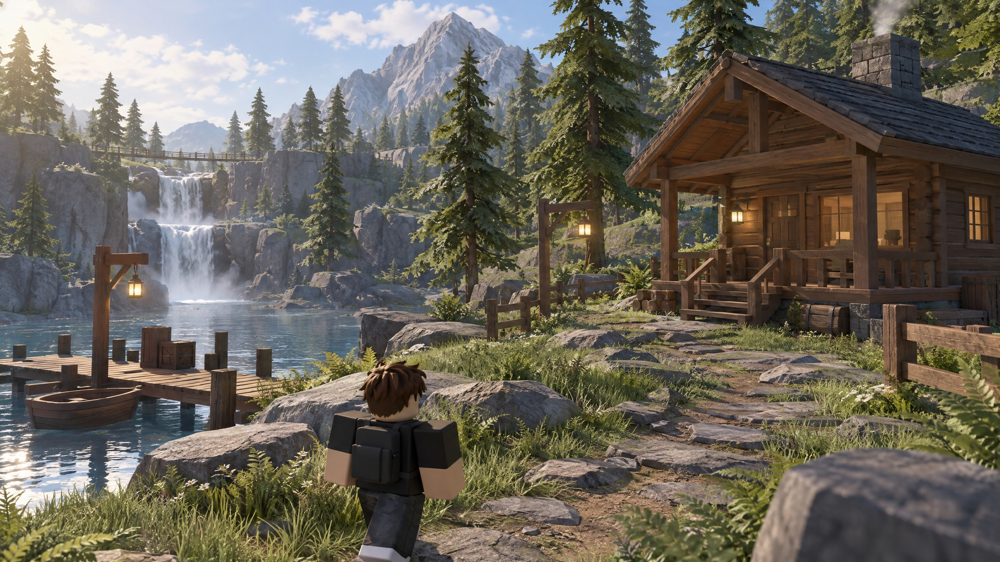
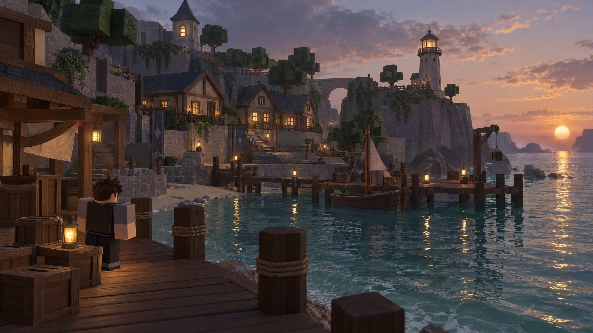
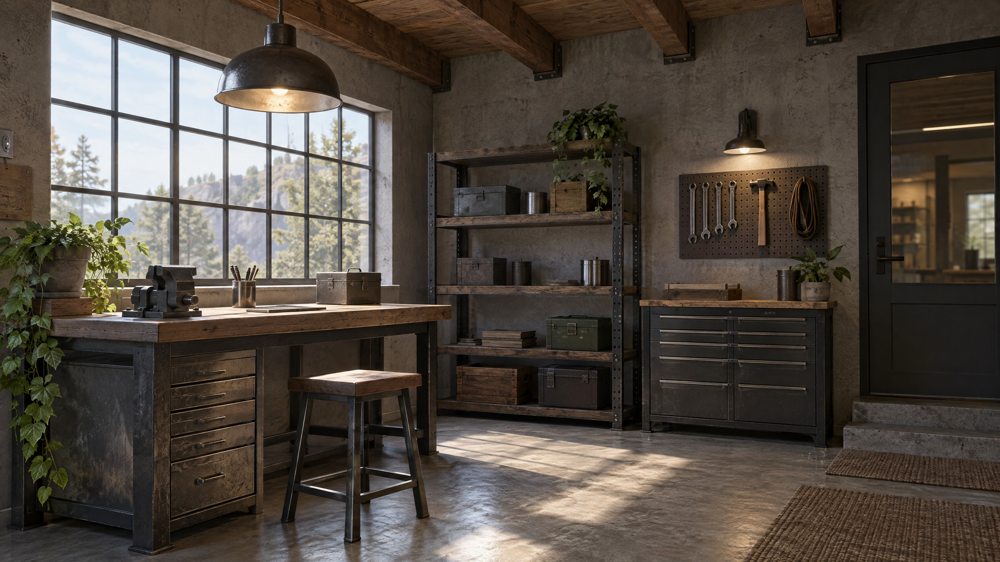

# H4Shira

<p align="center">
  
</p>

<p align="center">Rendering tools for Roblox Studio.</p>

H4Shira is a client-side Roblox system for lighting, atmosphere, material adjustments, camera priority, distance budgets, and runtime quality control.

## Quick start

1. Open the project in Roblox Studio.
2. Copy `Latest/ShadersLocalScript.lua`.
3. Create a `LocalScript` inside `StarterPlayer > StarterPlayerScripts`.
4. Paste the script and run the experience.

Use an earlier version when a smaller implementation is preferred.

## Versions

| Version | Main focus |
| --- | --- |
| `V1` | Future Lighting, atmosphere, water, Bloom and SunRays |
| `V2` | Basic material adjustments and dynamic lighting updates |
| `V3` | Camera priority, material preservation and exposure |
| `Latest` | Full H4S Rendering System with map analysis and runtime budgets |

## Optional attributes

Set these attributes on `Workspace` or on individual objects when needed:

```text
H4S_Style = "natural"
H4S_PreserveAesthetic = 0.85
H4S_KeepMaterial = true
H4S_Preserve = true
H4S_ForceMaterial = true
H4S_KeepLight = true
H4S_KeepParticles = true
```

Valid `H4S_Style` values are `natural`, `film`, `stylized`, and `balanced`.

## Test images

These images are reference scenes for visual checks. Keep the camera position and time of day consistent when comparing results.

### Natural daylight



### Evening light



### Interior materials



## Documentation

- [Installation](docs/installation.md)
- [Configuration](docs/configuration.md)
- [Architecture](docs/architecture.md)
- [Performance](docs/performance.md)
- [Testing guide](docs/testing.md)
- [Troubleshooting](docs/troubleshooting.md)
- [Versions](docs/versions.md)
- [Attributes and tags](examples/attributes.md)
- [Changelog](CHANGELOG.md)
- [Commercial SaaS License](LICENSE)

## Technical notes

- The scripts are client-side `LocalScript` objects.
- The project uses public Roblox APIs and Future lighting technology.
- Existing materials, colors and protected objects are preserved as much as possible.
- Custom PBR textures and `SurfaceAppearance` assets are not included.
- Test the selected version on the target PC, mobile and console devices.
- Roblox and Roblox Studio are trademarks of Roblox Corporation.

## License

Use is governed by the [H4Shira Commercial SaaS License](LICENSE).
